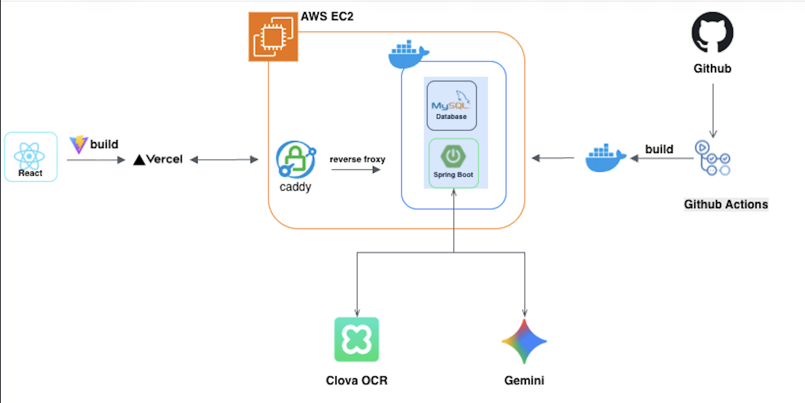

<div align="center">
  <h1>&lt;온하루&gt; - &lt;하루온&gt;</h1>
  <h3>독거 시니어와 보호자 사이의 복약·건강 관리 격차를 해소하는 서비스</h3>
  <p>
    처방전 등록부터 복약 알림, 복약 기록, 리포트까지 한 곳에서 관리하여<br />
    시니어 + 보호자 + 복지기관을 모두 연결하는 통합 복약 관리 플랫폼입니다.
  </p>
</div>

---

## 서비스 요약

- **서비스명**: 하루온 (OnHaru)
- **핵심 가치**: 독거/취약 시니어의 복약 루틴을 자동화하고, 보호자·복지기관이 실시간으로 상태를 확인할 수 있도록 지원
- **서비스 URL**: [https://onharu.my](https://onharu.my)

---

## 주제 구분

- **C타입 복지 사각지대 대상 서비스**: 위안부 피해자, 참전 용사, 독거 어르신 등 돌봄 사각지대 어르신의 복약 케어를 중심으로 설계

---

## 팀 소개

- **팀명**: 온하루 (OnHaru)
- **구성**: FE 및 BE 프로젝트 팀원은 아래에 있습니다
- **Frontend Repository**: [github.com/On-Haru/FE](https://github.com/On-Haru/FE)

---

## 시연 영상

- (추가 예정) – YouTube 링크를 통해 전체 데모 영상을 제공할 예정입니다.

---

## 서비스 소개

### 서비스 개요

시니어/케어 수급자의 복약 루틴은 약 처방 → 약 보관 → 알람 → 복약 확인 → 리포트까지 여러 단계와 사람의 개입이 필요합니다. OnHaru는
처방전을 기준으로 **약·스케줄·알림·복약 로그**를 일관된 데이터로 관리하고, AI를 통해 리포트/설명을 자동 작성하여 케어 부담을 줄입니다.

### 타 서비스와의 차별점

| 기존 서비스   | 기능                           | 한계                         |
|----------|------------------------------|----------------------------|
| 약먹자      | 복약 알림 설정, 약 정보 검색            | 보호자/복지기관 연계, 처방전 기반 자동화 부재 |
| 약 알림 태양이 | 복약 시간 알림, 미응답 시 전화 알림, 복약 기록 | 시니어-보호자 실시간 공유, AI 리포트 미지원 |

**하루온**은 다음 기능으로 차별화합니다.

1. 복약 알림 + 실시간 Taking Log 공유 (보호자/기관 전용 뷰)
2. 처방전 촬영 & OCR 인식으로 약/스케줄 정보 자동 등록
3. 고령층 맞춤 UI/UX + 보호자 전용 대시보드
4. AI 요약·위험 태그·개선 제안을 포함한 월간 리포트

---

## 구현 내용 및 결과물

1. **처방전 캡처 & OCR 기반 약 정보 자동 등록**
    - 처방전 이미지를 업로드하면 Naver Clova OCR + Spring AI 시나리오로 JSON을 생성하고, 약 이름/수량/기간/스케줄을 자동 매핑합니다.
2. **복약 스케줄 생성 & 실시간 푸시 알림**
    - 약 정보 등록과 동시에 `medicine_schedules` 및 푸시 알림이 생성되어 보호자 개입 없이 시니어에게 복약 알림을 전달합니다.
3. **Taking Log 자동 생성 & 월간 캘린더 기록**
    - 알림 발송 시점에 `TakingLog` 슬롯이 자동 생성되고, 복약 완료 여부에 따라 `COMPLETE/PARTIAL/MISSED/PLANNED` 상태를 계산합니다.
4. **AI 기반 복약 리포트 & 통계 제공**
    - TakingLog 기반 통계를 만든 뒤 Spring AI(OpenAI)로 요약 문장/위험 태그/개선 제안을 생성하여 월간 리포트를 자동 저장합니다.
5. **케어 네트워크 구성 & 역할 기반 인증**
    - Senior/Caregiver 계정을 분리 관리하고 JWT 기반 인증으로 연결하여, 보호자가 시니어 복약 현황·리포트·알림을 즉시 확인할 수 있습니다.

---

## 구현 방식

- **Frontend**: TypeScript + React + Vite, TailwindCSS & 커스텀 UI, React Router, Axios, GSAP, PWA(
  Service Worker) 구성
- **Backend**: Java 21, Spring Boot 3.3, Spring Validation, Spring Data JPA, Spring Security/JWT,
  Spring AI(OpenAI), Naver Clova OCR 연동
- **Messaging & Scheduler**: Spring `@Scheduled` 크론 기반 `MedicineAlarmScheduler`,
  ApplicationEventPublisher로 Push/TakingLog 분리 처리
- **Database**: MySQL(InnoDB), HikariCP, JPA EntityGraph 최적화
- **Infrastructure**: Docker, GitHub Actions 기반 무중단 배포, Web Push(VAPID), AWS EC2/ACM
- **로컬 실행**: `./gradlew bootRun` (환경 변수는 `.env` 혹은 시스템 환경 변수로 주입)

---

## 주요 링크 & 문서

- **서비스 URL**: [https://onharu.my](https://onharu.my)
- **API·기능 문서**: [`/docs`](docs) (처방전, Taking Log, Report 등)
- **Frontend Repository**: [github.com/On-Haru/FE](https://github.com/On-Haru/FE)
- **Swagger UI**: `/swagger-ui`
- **환경 변수 참고**: `src/main/resources/application.yaml`

---

## 시스템 아키텍처

<div align="center">
  
</div>

```
PrescriptionController
   └─ PrescriptionService ──┬─ PrescriptionMedicationService ──> MedicineSchedule / Medicine
                             └─ OCRClient + AiClient (이미지 업로드)

MedicineAlarmScheduler (@Scheduled)
   └─ MedicineAlarmEvent (ApplicationEventPublisher)
         ├─ Push 알림 (PushSubscriptionService)
         └─ TakingLogService.recordTaking → TakingLog 저장

TakingLogMonthlyCalculator
   └─ TakingLog + MedicineSchedule 로 DaySummary/SlotSummary 생성

ReportController
   └─ StatisticsService → PromptManager → AiClient → ReportService
```

- **Event Driven**: 복약 알림 이벤트 하나로 Push 알림과 TakingLog 생성을 동시에 처리
- **AI Pipeline**: 통계 → 프롬프트 → AI 응답 → ReportPayload 저장
- **Planned Slots**: 미래 스케줄을 합성하여 월간 캘린더에 PLANNED 상태를 표시

---

## 도메인 하이라이트

| 엔티티                                                | 설명                                     |
|----------------------------------------------------|----------------------------------------|
| `users`, `caregivers`                              | 시니어/보호자 계정, JWT 인증, 역할 기반 접근 제어        |
| `prescriptions`, `medicines`, `medicine_schedules` | 처방전 → 약 → 복약 스케줄 체인, OCR 및 수동 입력 모두 지원 |
| `taking_logs`                                      | 알림 슬롯/복약 기록, 미래 스케줄과 결합해 DayStatus 계산  |
| `reports`                                          | 월간 복약 리포트 JSON 저장, AI 호출 최소화           |
| `push`                                             | VAPID 기반 Web Push 구독자 관리               |

---

## 향후 개선 및 발전 방향

1. **서비스 고도화 및 기능 확장**
    - 성분 중복 감지, 부작용 위험 예측, 약 상호작용 분석 등 의료 보조 기능을 추가하여 더 정밀한 케어 데이터 제공.
2. **IoT 기기 연동**
    - 스마트 약통/웨어러블과 연동하여 복약 완료 여부를 자동 감지, 사용자 입력 의존도를 낮추고 정확한 실시간 데이터 수집.
3. **약 보관·재고/유통기한 관리**
    - 유통기한 임박 알림, 남은 복약량 기반 재구매 시점 안내 기능으로 약 관리 전반을 자동화.
4. **음성 UX 확대**
    - 음성 안내 알림, 음성 복약 확인 등 고령층 친화 기능을 강화하여 접근성 향상.

---

## 로컬 실행 요약

```bash
./gradlew bootRun
```

- 사전 준비: `.env` 파일 또는 시스템 환경 변수에 `DB_URL`, `DB_USERNAME`, `DB_PASSWORD`, `OPENAI_API_KEY`,
  `NAVER_OCR_*`, `JWT_SECRET`, `PUBLIC/PRIVATE_VAPID_KEY` 등을 설정합니다.
- Swagger: `http://localhost:8080/swagger-ui`
- 주요 API 문서: `docs/prescription-api.md`, `docs/takinglog-api.md`, `docs/report-api.md`

### 1. 처방전 캡처 & OCR 후처리

- `POST /api/prescriptions` 로 시니어·병원 정보와 약/스케줄을 한 번에 등록.
- `POST /api/prescriptions/upload` 는 Naver OCR + Spring AI 시나리오로 이미지 → 구조화 JSON 변환.
- 약 메모, 총 수량, 기간, 시간대 태그를 그대로 스케줄에 반영하여 등록 과정을 단순화합니다.

### 2. 복약 스케줄 & 실시간 알림

- `medicine_schedules` 를 기반으로 정해진 요일/시간대마다 푸시 알림을 발송 (`MedicineAlarmScheduler`).
- `PushSubscriptionService` 가 디바이스 구독을 관리해 시니어별로 맞춤 알림을 전송합니다.

### 3. Taking Log & 월간 캘린더

- 알림이 발송되면 `MedicineAlarmEvent → TakingLogService` 흐름으로 슬롯을 자동 생성.
- `GET /api/taking-logs/calendar` 는 실제 기록 + 미래 스케줄을 결합해 DayStatus(
  NONE/PLANNED/PARTIAL/COMPLETE/MISSED)를 계산합니다.
- 미래 날짜라도 스케줄이 존재하면 PLANNED로 표시되어 케어 계획을 미리 확인할 수 있습니다.

### 4. AI 복약 리포트 & 통계

- `GET /api/reports` 는 TakingLog 통계를 기반으로 ReportPayload를 만들고, Spring AI(OpenAI)로 요약·위험 태그·제안을 생성합니다.
- 리포트가 없으면 즉시 생성 후 저장하여, 월별 복약 현황을 손쉽게 공유할 수 있습니다.

### 5. 케어 네트워크 & 사용자 권한

- `caregiver` / `senior` 도메인이 서로 연결되어 케어매니저, 가족, 시니어 계정을 분리 관리합니다.
- JWT 기반 인증과 역할(Role) 검증으로 API 접근을 제어합니다.

---

## 🚀 Tech Stack Overview

### 💻 Core Backend


### 🗄 Database Layer

-4479A1?style=for-the-badge&logo=mysql&logoColor=white)


### 🤖 AI & OCR


### 🔔 Messaging & Scheduling


### 🔐 Security & Auth

-000000?style=for-the-badge&logo=jsonwebtokens&logoColor=white)


### ☁️ AWS Infrastructure


### 🚚 CI/CD & Container


### 💻 Frontend


### 🔧 Dev Tools


---

## 🏗 Architecture Snapshot

### Backend Architecture

<div align="center">
  
</div>

```
PrescriptionController
   └─ PrescriptionService ──┬─ PrescriptionMedicationService ──> MedicineSchedule / Medicine
                             └─ OCRClient + AiClient (이미지 업로드)

MedicineAlarmScheduler (@Scheduled)
   └─ MedicineAlarmEvent (ApplicationEventPublisher)
         ├─ Push 알림 (PushSubscriptionService)
         └─ TakingLogService.recordTaking → TakingLog 저장

TakingLogMonthlyCalculator
   └─ TakingLog + MedicineSchedule 로 DaySummary/SlotSummary 생성

ReportController
   └─ StatisticsService → PromptManager → AiClient → ReportService
```

- **Event Driven**: 복약 알림은 이벤트를 통해 TakingLog와 Push에 동시에 전달되어 도메인 간 의존을 줄였습니다.
- **AI Pipeline**: 통계 → 프롬프트 → AI 응답 → ReportPayload 로 이어지는 단방향 파이프라인.
- **Planned Slots**: 월간 캘린더는 미래 스케줄을 합성하여 아직 발생하지 않은 복약도 미리 보여줍니다.

### Frontend Architecture

```
App (React Router)
   ├─ Layout (Header + Footer)
   │
   ├─ Auth Pages
   │   ├─ RoleSelectPage
   │   ├─ LoginPage
   │   └─ SignupPage
   │
   ├─ Caregiver Pages
   │   ├─ HomePage (케어 수급자 목록, 미복용 약 알림)
   │   ├─ DetailPage (월간 캘린더, 복약 기록)
   │   ├─ MedicineRegisterPage (처방전 촬영 & OCR)
   │   ├─ MedicineDetailPage (처방전 상세 & 수정)
   │   ├─ PreviousMedicinePage (이전 처방전 목록)
   │   ├─ ReportPage (AI 리포트)
   │   └─ MyPagePage
   │
   └─ Elder Pages
       └─ ElderHomePage (오늘의 약, 복용 확인)

Components
   ├─ BaseModal (공통 모달 컴포넌트)
   ├─ ToastContext (에러/성공 메시지)
   └─ Service Workers (PWA, Push 알림)
```

- **Component-based**: 재사용 가능한 컴포넌트 구조 (BaseModal, TableList, AlarmList 등)
- **Context API**: Toast 메시지, Install Prompt 등 전역 상태 관리
- **Custom Hooks**: useTodayMedications, usePushSubscription 등 비즈니스 로직 분리
- **PWA Support**: Service Worker를 통한 오프라인 지원 및 푸시 알림

---

## 📊 Monitoring & Ops Notes

- `logging.level` 은 기본 INFO, `com.example.onharu` 는 DEBUG 로 설정하여 서버 장애를 즉시 파악합니다 (
  `application.yaml`).
- Hibernate SQL 로깅 및 슬로우 쿼리 로그(`LOG_QUERIES_SLOWER_THAN_MS`)로 DB 이슈를 추적합니다.
- `.env` 기반 설정으로 로컬/운영 환경을 분리하며, Push/AI/OCR 자격 증명은 환경 변수로 관리합니다.

---

## 🗄 Domain Highlights

| 테이블/엔티티                                            | 역할                                     |
|----------------------------------------------------|----------------------------------------|
| `prescriptions`, `medicines`, `medicine_schedules` | 처방전 → 약 → 복약 스케줄 체인, OCR 및 수동 입력 모두 지원 |
| `taking_logs`                                      | 알림 슬롯/복약 기록. 미래 스케줄과 결합해 DayStatus 계산  |
| `reports`                                          | 월간 복약 리포트 JSON을 저장하여 반복 AI 호출을 최소화     |
| `users`, `caregivers`, `auth` 모듈                   | 시니어/케어 계정 및 JWT 인증                     |
| `push`                                             | VAPID 키 기반 WebPush 구독자 관리              |

---

## 📁 Jump-start Guide

### Backend Setup

1. **의존성 설치**: `./gradlew dependencies` (필요 시 로컬 Gradle 캐시 준비)
2. **환경 변수**: `.env` 또는 시스템 환경변수에 `DB_URL`, `OPENAI_API_KEY`, `NAVER_OCR_*`, `JWT_SECRET` 등을 설정
3. **DB 준비**: MySQL에 `onharu` 스키마 생성 → `application.yaml` 의 URL/계정 매핑
4. **실행**: `./gradlew bootRun`
5. **스웨거(UI)**: `/swagger-ui` (springdoc starter 기반)
6. **주요 API 확인**:
    - 처방전: `docs/prescription-api.md`
    - 복약 기록/캘린더: `docs/takinglog-api.md`
    - 리포트 & AI: `docs/report-api.md`, `docs/report-module.md`

### Frontend Setup

1. **의존성 설치**: `pnpm install` (또는 `npm install`)
2. **환경 변수**: `.env` 파일에 `VITE_API_BASE_URL` 설정 (백엔드 API URL)
3. **개발 서버 실행**: `pnpm dev` (기본 포트: 5173)
4. **빌드**: `pnpm build` (프로덕션 빌드)
5. **프리뷰**: `pnpm preview` (빌드된 앱 미리보기)

#### 주요 페이지 구조

- **인증**: `/login`, `/signup` - JWT 기반 인증
- **홈**: `/home` - 케어 수급자 목록, 미복용 약 알림
- **처방전 관리**:
    - `/medicine/register` - 카메라로 처방전 촬영 & OCR
    - `/medicine/detail` - 처방전 상세 보기 & 수정
    - `/medicine/previous` - 이전 처방전 목록
- **복약 기록**: `/detail/:id` - 월간 캘린더, 복약 기록 확인
- **리포트**: `/report` - AI 기반 월간 복약 리포트
- **시니어 앱**: `/elder` - 오늘의 약, 복용 확인

#### 주요 기능

- **처방전 OCR**: 카메라 촬영 → Naver OCR → 자동 약 정보 추출
- **실시간 알림**: Web Push를 통한 복약 알림
- **PWA**: 모바일 앱처럼 설치 가능, 오프라인 지원
- **반응형 디자인**: 모바일 우선 설계 (393px 기준)

---

## 👥 프로젝트 팀원

|                                                            Backend                                                            |                                                         Frontend                                                          |                                                             Frontend                                                              |                                                           Frontend                                                            |
|:-----------------------------------------------------------------------------------------------------------------------------:|:-------------------------------------------------------------------------------------------------------------------------:|:---------------------------------------------------------------------------------------------------------------------------------:|:-----------------------------------------------------------------------------------------------------------------------------:|
|  <br> **[장보형](https://github.com/jbh010204)** |  <br> **[차서현](https://github.com/cktjgus)** |  <br> **[박지현](https://github.com/parkjihyoun)** |  <br> **[신여원](https://github.com/sinyeowon)** |
|                                                          **Backend**                                                          |                                                       **Frontend**                                                        |                                                           **Frontend**                                                            |                                                         **Frontend**                                                          |

문의: `support@onharu.example`
